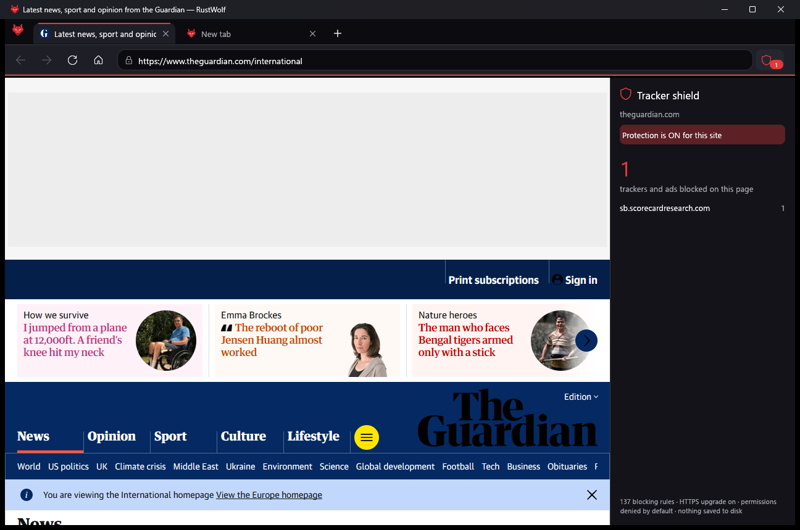

# RustWolf

A privacy-first web browser **written in Rust**, built on **[Servo](https://servo.org)**, the web engine written in Rust.

## Download
Get **RustWolf-win64.zip** from the [latest release](../../releases/latest), unzip it and run `RustWolf.exe` (Windows 10/11, no install needed).
New builds are made automatically by [GitHub Actions](.github/workflows/build.yml) on every change and every week, so Servo and dependency fixes keep arriving.

## Features
- Tabs (middle-click to close), address bar that also searches with DuckDuckGo, back / forward / reload / home, loading bar, page titles and favicons.
- **Built-in tracker & ad blocking** with Brave's Rust ad-block engine ([`adblock`](https://crates.io/crates/adblock)), a per-site shield switch and a live "blocked" counter with the list of blocked domains. Add your own lists (e.g. EasyList) in `%APPDATA%\RustWolf\filters.txt`.
- **HTTPS upgrade** for every page (except local addresses).
- **Private by default:** cookies, cache and history live in memory only; nothing is written to disk.
- Camera, microphone, location and notification requests are **denied automatically**.
- **No telemetry** of any kind.
- Low RAM: background tabs are throttled; only the visible tab renders.
- Shortcuts: Ctrl+T, Ctrl+W, Ctrl+L / F6, Ctrl+Tab, Ctrl+Shift+Tab, Ctrl+1–9, Ctrl+R / F5, Alt+Left / Right.
- Original red-wolf logo drawn in code ([src/logo.rs](src/logo.rs)).

## Limits (Servo is still young)
- No DRM (Netflix, Spotify Web, Disney+ won't play) and no browser extensions.
- Some complex sites render incorrectly; dropdowns and page dialogs are basic.

## Build
`cargo build --release` (Rust 1.88+, Windows SDK / MSVC). Servo's JavaScript engine (SpiderMonkey) is downloaded prebuilt by the `mozjs_sys` crate.

## License
MPL-2.0. `src/keyutils.rs` comes from Servo's servoshell (MPL-2.0).
